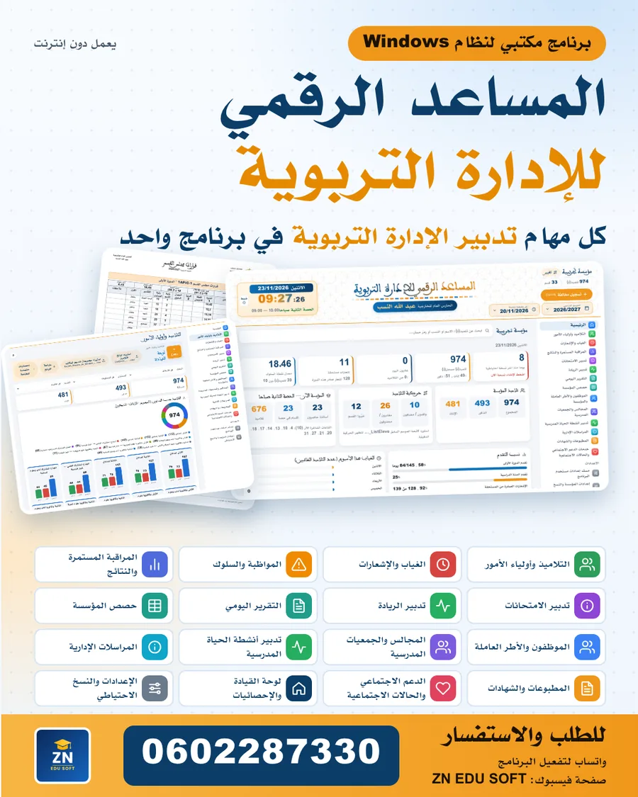
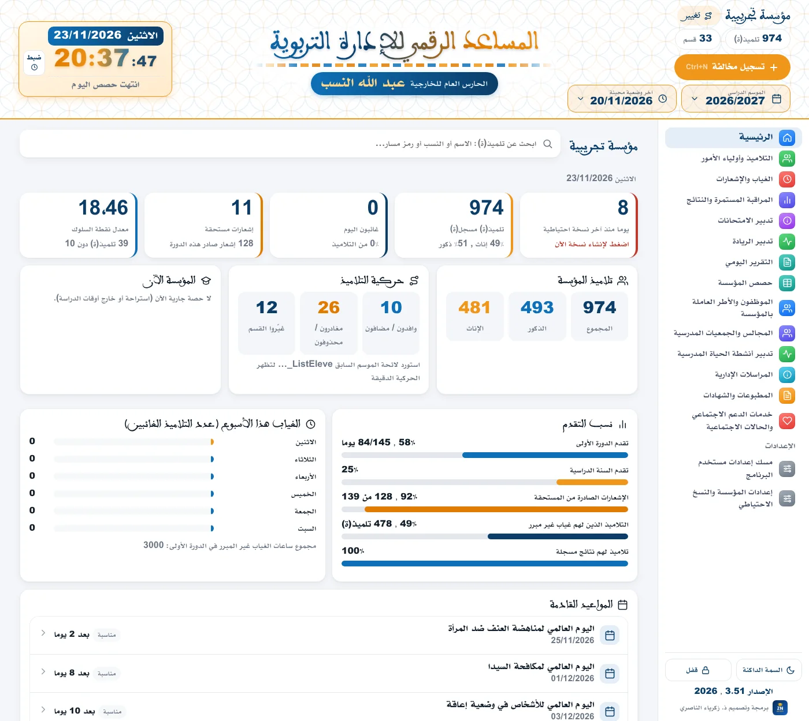
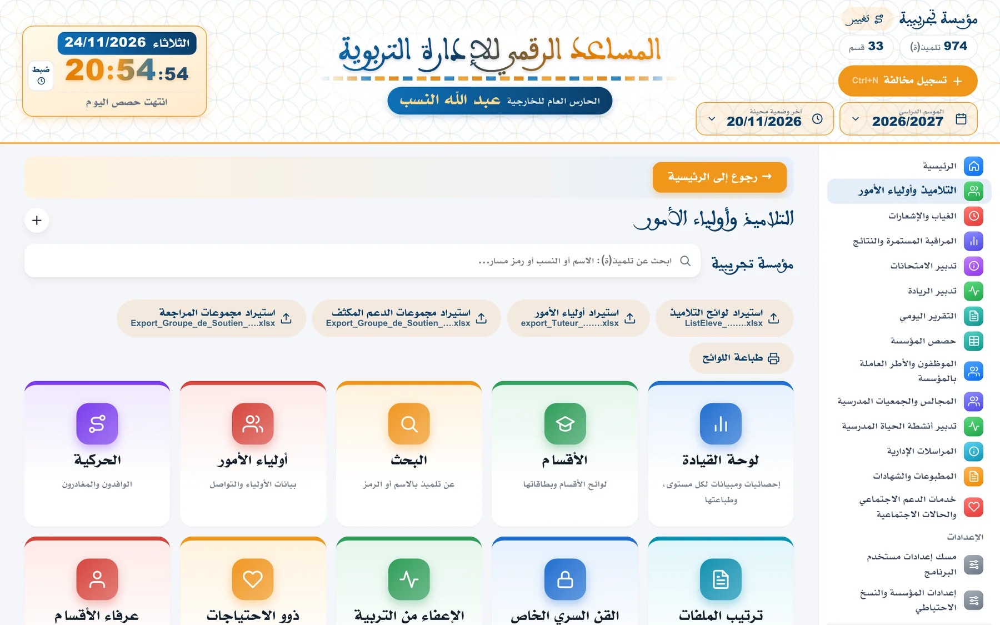
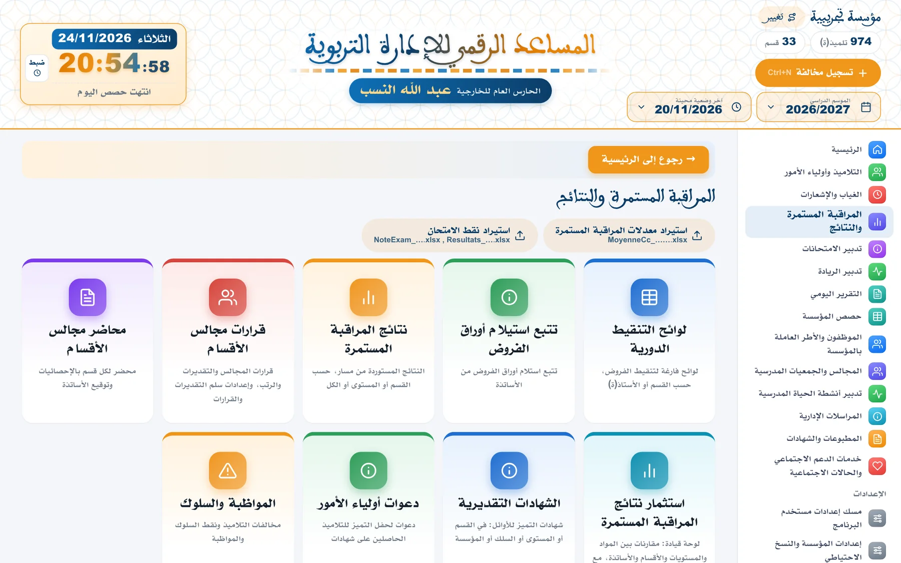
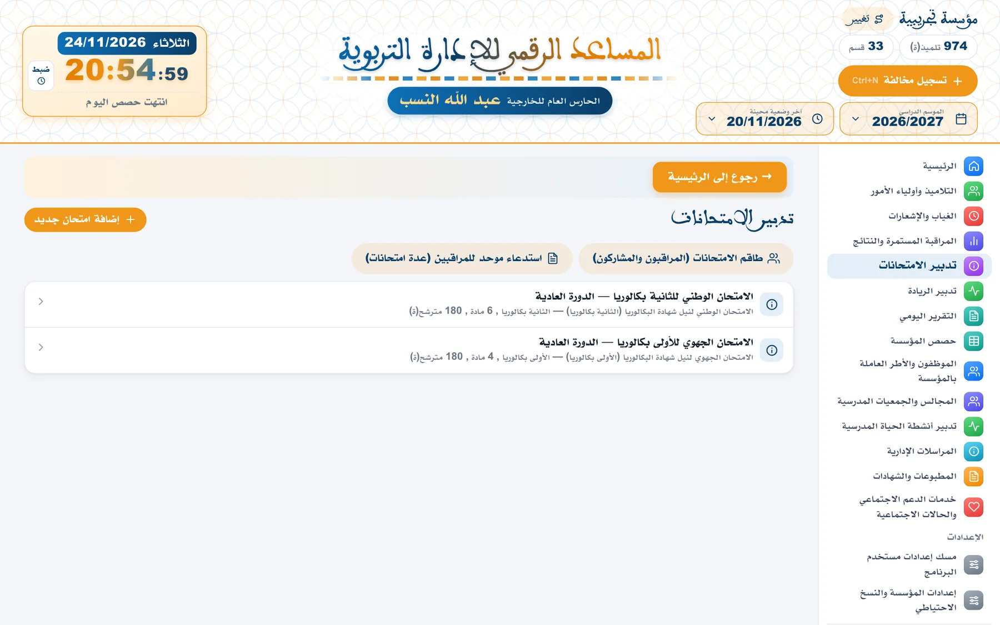
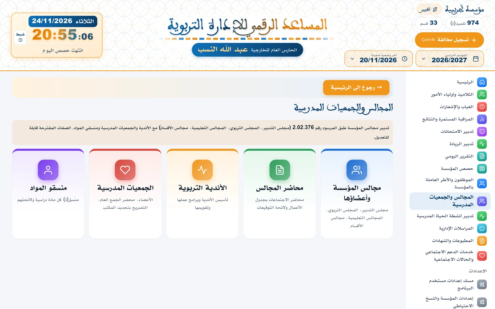
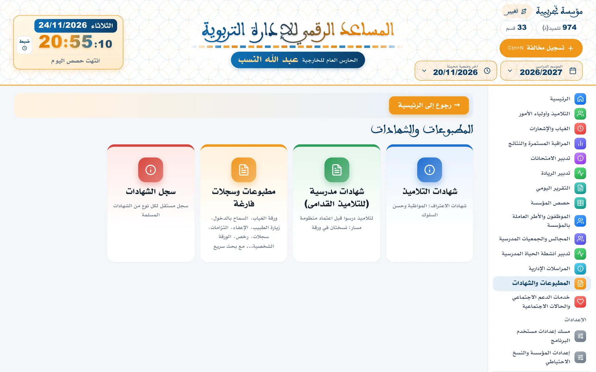

# المساعد الرقمي للإدارة التربوية

**كل مهام تدبير الإدارة التربوية في برنامج واحد** · برنامج مكتبي لنظام Windows يعمل دون إنترنت

## المكونات

التلاميذ وأولياء الأمور · الغياب والإشعارات · المواظبة والسلوك · المراقبة المستمرة والنتائج · تدبير الامتحانات · تدبير الريادة · التقرير اليومي · حصص المؤسسة · الموظفون والأطر العاملة · المجالس والجمعيات المدرسية · تدبير أنشطة الحياة المدرسية · المراسلات الإدارية · المطبوعات والشهادات · الدعم الاجتماعي.

## لقطات

| | |
|---|---|
|  |  |
|  |  |
|  |  |

اللقطات من مؤسسة تجريبية ببيانات وهمية. ولمزيد من اللقطات ونماذج الوثائق زوروا [صفحة البرنامج](https://znedusoft.github.io/gs-assistant/).

## شروحات بالفيديو

سننشر قريبا فيديوهات تعرّف بالبرنامج وتشرح طريقة إعداده والعمل في كل مكوّن، على صفحتنا في فيسبوك: [ZN EDU SOFT](https://www.facebook.com/ZN.EDU.SOFT).

## متطلبات التشغيل

Windows 10/11 (64 بت) · 4 غيغابايت ذاكرة · 500 ميغابايت قرص · لا يحتاج إنترنت.

## التنصيب والتفعيل

1. نزّل ملف التنصيب `.exe` من [Releases](https://github.com/ZNEDUSOFT/gs-assistant/releases/latest) وشغّله (إن ظهر تنبيه Windows: **More info ثم Run anyway**). وإن حجب متصفحك أو برنامج الحماية التنزيل فنزّل نسخة **ZIP** من الصفحة نفسها وفك ضغطها.
2. افتح البرنامج، وانسخ **رمز الحاسوب** من شاشة التفعيل.
3. اطلب التفعيل عبر واتساب على **0602287330** (أو بزر «طلب التفعيل عبر واتساب» داخل البرنامج).
4. ألصق رمز التفعيل واضغط **تفعيل**. التفعيل مدى الحياة ومرتبط بالحاسوب.

صفحة فيسبوك: [ZN EDU SOFT](http://www.facebook.com/ZN.EDU.SOFT)

---
برمجة وتصميم ذ. زكرياء الناصري

